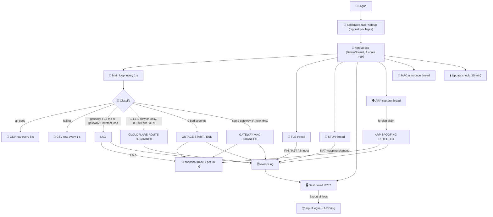

# 🐛 netbug

A small always-on Windows tool that catches **intermittent network drops** the moment they happen, records enough evidence to say *where* the problem is, and protects the laptop against **ARP spoofing** on a shared LAN.

---

## 🎯 Why it exists

On a wired hostel connection (Windows 11, a USB-C RTL8153 dongle, a MikroTik-gatewayed LAN, TM Unifi upstream), roughly once every 4 days:

1. 🎙️ Discord voice ping jumps to **5000 ms**: friends can't hear you, but you still hear them.
2. 🔄 About 20 s later Discord spins and Valorant rubberbands, then disconnects.
3. 🌫️ The **whole internet hangs** without an error page.
4. 🔌 Replugging the cable shows **"connected, no internet"**.
5. ⏳ Minutes later it fixes itself.

Nothing in Windows explained it, so netbug watches every layer and timestamps what breaks first.

> 🎯 **Found it (2026-10-28 05:34, and again 15:28 from the same device):** another device on the hostel LAN was **ARP spoofing the gateway**. It told the laptop "I'm the router", then swallowed every packet. netbug caught the gateway MAC change, the outage and the spoofed ARP replies live.
> - Write-up: [`REDACTED_INCIDENT_2026-10-28_ARP_SPOOFING.md`](REDACTED_INCIDENT_2026-10-28_ARP_SPOOFING.md)
> - Report for the hostel: [`REDACTED_RCC_REPORT.md`](REDACTED_RCC_REPORT.md)
> - 🎬 Narrated explainer (2:22, both attacks): [`video/incident-v4-redacted.mp4`](video/incident-v4-redacted.mp4). A 3D v5 (3:26: every incident, the fix, prevention) is in `video/src/v5/`, rendered locally (see [`video/README.md`](video/README.md)).

---

## 🚀 Setup

### Requirements

- Windows 10 2004+ or Windows 11 (for `pktmon`)
- Admin rights (packet captures, ARP entries, the dashboard on port 8787)
- Nothing to install: it builds with the C# compiler that ships with Windows (.NET Framework 4.x)

### Quick install (no build)

1. Download `netbug.exe` from [Releases](https://github.com/tariqaq/netbug/releases/latest).
2. Double-click it and accept the admin prompt (UAC). It isn't code-signed, so SmartScreen may say "Windows protected your PC": click **More info**, then **Run anyway**.
3. Then do [step 4](#4-protect-the-laptop).

It installs itself to `C:\ProgramData\netbug`, sets up the `netbug` logon task (the same settings as step 2 below), starts, and opens the dashboard. More in [Sending netbug to a friend](#-sending-netbug-to-a-friend).

### 1. Build

In PowerShell, from the repo folder:

```powershell
pwsh -File tools\build.ps1
```

This makes `tools\netbug.exe` (or the path given with `-Out`), with the dashboard page, font and scripts embedded in it. The assembly is always named `netbug`, whatever the file is called, because the updater checks the name.

Known router MACs for the **Router MAC** dropdown: put them in `tools\routers.local.txt` (gitignored), one per line as `<gateway ip> <MAC> [label]`, with `#` for comments. `build.ps1` embeds the file when it exists and warns when it doesn't. The release exe is built with it. The dropdown also lists the pinned MAC and the MAC the last check found.

### 2. Start it at every logon

Double-click `tools\netbug.exe` and accept the admin prompt. When no `netbug` task exists, it registers one for itself and keeps running. An existing `netbug` task is left as it is.

The same task by hand, in an **admin** PowerShell from the repo folder:

```powershell
$tools = "$PWD\tools"
Register-ScheduledTask netbug `
  -Action    (New-ScheduledTaskAction -Execute "$tools\netbug.exe" -WorkingDirectory $tools) `
  -Trigger   (New-ScheduledTaskTrigger -AtLogOn -User $env:USERNAME) `
  -Principal (New-ScheduledTaskPrincipal -UserId $env:USERNAME -LogonType Interactive -RunLevel Highest) `
  -Settings  (New-ScheduledTaskSettingsSet -ExecutionTimeLimit ([TimeSpan]::Zero) -RestartCount 999 `
              -RestartInterval (New-TimeSpan -Minutes 1) -AllowStartIfOnBatteries -DontStopIfGoingOnBatteries `
              -MultipleInstances IgnoreNew)
Start-ScheduledTask netbug
```

### 3. Open the dashboard

Go to **http://localhost:8787/** on the laptop. Logs land in `logs\` (gitignored).

### 4. Protect the laptop

In the dashboard's **Router protection** panel:

1. Pin the router, either way:
   - **Shortcut:** if **Router MAC** lists a known router, click **Test and pin**. It pins the MAC only if the test proves it's the real router.
   - **Otherwise, or if that test fails:** click **Check now** (the connection drops for a few seconds while it tests). When it names the real router, turn on **Pin it permanently**.
2. Leave **Keep the router updated** on (it is by default).

### Updating

The repo copy doesn't update itself. It checks GitHub every 15 minutes and, when a newer release is out, says so on the page and in `events.log`. The running exe can't be overwritten, so after `git pull`, in an admin PowerShell:

```powershell
Stop-ScheduledTask netbug; Get-Process netbug -ErrorAction SilentlyContinue | Stop-Process -Force
# rebuild (step 1), then:
Start-ScheduledTask netbug
```

`tools\dashboard.html` is read from disk on every request, so page edits need no rebuild.

### Uninstalling

Run `tools\netbug.exe --uninstall` and accept the admin prompt. It:
- stops netbug and its packet capture
- removes the `netbug` task
- removes the router pin

Logs in `logs\` stay. The same by hand, in an admin PowerShell:

```powershell
Stop-ScheduledTask netbug; Get-Process netbug -ErrorAction SilentlyContinue | Stop-Process -Force
Unregister-ScheduledTask netbug -Confirm:$false
pktmon stop
```

Then remove the pin (see [Pinning by hand](#-pinning-by-hand)).

---

## 🤝 Sending netbug to a friend

Send them the [latest release](https://github.com/tariqaq/netbug/releases/latest) link, or `tools\netbug.exe` itself (zip it if the chat app blocks `.exe`). The exe is self-contained.

1. They double-click it and accept the admin prompt (UAC).
2. It installs itself and their browser opens `http://localhost:8787/`.
3. In **Router protection**, pin the router: **Test and pin** on the known router, or **Check now** then **Pin it permanently**. See [step 4](#4-protect-the-laptop).

A lone exe (no `dashboard.html` next to it) installs itself on the first run:
- copies itself to `C:\ProgramData\netbug\netbug.exe` (only admins can change that folder)
- registers the `netbug` logon task with the same settings as on this laptop, and starts it
- puts its logs in `C:\ProgramData\netbug\logs`

It then runs like the repo copy, with two differences:
- The panel has an **Uninstall netbug** button (click twice).
- It **updates itself**: 2 minutes after it starts and then every 15 minutes, it asks GitHub for the [latest release](https://github.com/tariqaq/netbug/releases/latest). One check is about 12 KB, and an unchanged release comes back empty (netbug sends the last reply's ETag). GitHub allows 60 checks an hour per public IP without an account, shared by everyone behind that IP, so 4 an hour leaves room. When the release is newer than the running version (v1.0.4 onward), it installs it by itself, waiting until no router check is running. **Install update now** in **Logs and updates** does the same at once. netbug restarts for a few seconds and the page reloads.

How an update installs:
1. The release's `netbug.exe` is downloaded to `C:\ProgramData\netbug\netbug.new.exe`. It must match the SHA-256 GitHub lists for the file (this catches a corrupted or swapped download, not a release made by someone who took over the GitHub account) and be a build named netbug, of at least the release's version, or it's thrown away.
2. The running `netbug.exe` is renamed to `netbug.old.exe` (kept as a fallback), and the new file takes its name.
3. netbug restarts through its logon task: a helper copy waits for the old process to exit, then starts the task, so the new copy runs under the task and its restart-after-a-crash covers it. The new copy unpacks its page and scripts and takes over. A health restart (past the memory, handle or thread limits) works the same way.

The logon task and the logs stay as they are. If the dashboard ever shows a stale page, reload it: the page reloads itself after any netbug restart.

Double-click again:

| What they run | What happens |
|---|---|
| The same build again | Only opens the page. |
| A different build (newer or older) | Replaces the installed copy, restarts it, opens the page. Before v1.0.4 this was the only way to update. An older build is replaced again by the next update check. |

To uninstall, use the button, or run `netbug.exe --uninstall`. Either way it removes the task, the router pin and netbug's program files in `C:\ProgramData\netbug` (the exe, the page and scripts). The logs in `C:\ProgramData\netbug\logs` stay; installing again appends to them.

> ⚠️ The exe isn't code-signed: SmartScreen may say "Windows protected your PC" (More info → Run anyway), and some antivirus tools may flag a program that asks for admin and runs `netsh` and `pktmon`.

---

## 🛡️ Router protection

The panel only appears on the laptop itself (`http://localhost:8787/`).

The status at the top right of the panel:

| Status | Meaning |
|---|---|
| **Protected** (green) | The gateway is pinned to a MAC. Fake router replies are ignored. |
| **Not pinned** (orange) | No pin. If a check has found the real router, the line under it names that router's MAC. If not, it shows the current ARP entry and asks you to run a check or test a router MAC. |
| **Pin differs** (red) | The pinned MAC isn't the one the last check found. If the router was replaced, turn the pin off and on again. |
| **Checking…** (orange) | A check is running. The connection drops for a few seconds per tested MAC. |
| **No network** (orange) | No adapter with a gateway. |

| Control | What it does |
|---|---|
| **Router MAC** + **Test and pin** | The dropdown lists the known routers built into the exe for the current gateway IP, the pinned MAC ("pinned now") and the MAC the last check found, plus **Other MAC…** to type one. **Test and pin** runs the Check now test on that one MAC, without the 10 s listen. It pins the MAC only if it passes; a failed test changes nothing, so use **Check now** then. The button reads **Already pinned** when that MAC is the pin. |
| **Check now** | Finds the real router MAC. Candidates: the ARP entry, any pin, the known routers for this gateway IP, and every MAC that answers for the gateway IP during 10 s of the ARP capture (the laptop asks for the router meanwhile, unless pinned). Each is set briefly as a temporary static ARP entry: it's the real router when internet pings pass **and** a TTL-1 ping comes back "TTL expired" from the gateway IP itself. The entry is then put back. |
| **Auto-detect the real router** | Runs a check now, every 30 min, when the gateway changes, and after a spoofing alert (at most every 5 min). It never changes a pin by itself. |
| **Pin it permanently** | Pins the verified MAC (`netsh … store=persistent`), so Windows ignores fake "I am the router" replies, even after a restart. Turn it off before using the same adapter on another network with the same router address. |
| **Keep the router updated** (on by default) | The pin only protects the laptop's own table. An attacker can still tell the *router* that the laptop's IP is their MAC. About once a second netbug makes Windows send a fresh ARP request (a broadcast carrying the laptop's real IP and MAC), so the router corrects a fake entry within about a second. The panel shows how many were sent, and how many the last capture check saw on the wire and over what period (normally the 5 min before it). |

Limits: a router that ignores unrequested ARP isn't helped by the announce, and a fake claim sent only to the router never reaches the laptop. The real fix is on the hostel's switch (DHCP snooping + Dynamic ARP Inspection).

The control API (`/api/fix…`) only accepts requests from loopback, with a `Host` of `localhost`/`127.0.0.1` (blocks DNS rebinding) and the per-run token the page got (`X-Netbug-Token`). Other websites can't read the token or send that header.

### 📌 Pinning by hand

```powershell
netsh interface ipv4 add neighbors "<adapter name>" <gateway ip> <real gateway mac> store=persistent   # pin
netsh interface ipv4 delete neighbors "<adapter name>" <gateway ip>                                     # unpin
```

If the gateway stops answering while pinned (for example the router was replaced), the outage event says the pin may be stale and prints the unpin command.

---

## 🔍 What it checks

| ⏱️ Every | 🔍 Check | 🎯 Catches |
|---|---|---|
| 1 s | Ping gateway, `1.1.1.1`, `8.8.8.8` (in parallel); tx/rx packet counters | LAN lag, internet loss, one-way traffic |
| 1 s (judging the last 30 s) | Cloudflare route: `1.1.1.1` losing 20%+ of its pings, or its median at twice its usual time (and 5 ms more), while `8.8.8.8` answers | `CLOUDFLARE ROUTE DEGRADED`: Discord, Claude and other Cloudflare-hosted services suffer while everything else is fine |
| On Windows network events, 1 s while failing, else 10 s | Active interface and its type (ethernet / wifi / ...), its Wi-Fi network (SSID, re-read at most every 10 s), link state of the wired adapter last used, VPN adapters that are up, and the adapter Windows routes 1.1.1.1 through | Cable/link drops, hotspot switch, a VPN (WARP, Tailscale exit node, ExpressVPN...) carrying the internet traffic |
| 2 s (again as soon as a failed one finishes) | DNS query to the router | Resolver stalls ("sites load forever") |
| 2 s | STUN on one long-lived UDP socket (Cloudflare, then Google); after 3 failures in a row it opens a new socket once and resolves the servers again | UDP loss, **NAT mapping changes** (what kills voice/game sessions) |
| 10 s (again as soon as a failed one finishes) | TCP connect to `github.com:443`, and to `1.1.1.1:443` when that fails (fails only when both do) | New connections failing |
| 10 s | UDP ports per process; gateway MAC and ARP entry type (static = pinned) | Port leaks, **gateway MAC change** (alert + snapshot), pin removed |
| Always (judged every 5 min and at each snapshot) | ARP-only `pktmon` capture in real-time mode (no capture files, no gaps), last 15 min kept in memory | **Any other device claiming the gateway IP or this laptop's IP** = `ARP SPOOFING DETECTED` |
| ~1 s | MAC announce (see Router protection) | Not a check: keeps the router's entry for this laptop correct |
| 15 s | HEAD on one long-lived TLS connection | Connections silently killed (FIN / RST / timeout) |
| 5 min | Public IP | ISP / PPPoE reconnects |
| 15 min (first 2 min after start) | Latest GitHub release | A newer netbug (a lone exe installs it, see [Sending netbug to a friend](#-sending-netbug-to-a-friend)) |
| 1 h | Own RAM / handles / threads | Leaks (restarts through the logon task past limits) |

🚨 **Outage** = no interface, or both internet pings, DNS, TCP or UDP failing **2 seconds in a row**. It counts from the first bad second. Gateway-only ping loss doesn't count (the router rate-limits ICMP), and neither does a degraded Cloudflare route.

A round never waits for a slow probe: the DNS query, the TCP connect and the gateway MAC read run in the background, and a round uses the results that arrive within 900 ms of its start (a slower one in a later round). So rows stay 1 s apart during outages, and each row is stamped with the time its pings went out. The schedules follow a monotonic clock, so a change of the system time neither freezes nor bunches them. More than 30 s between two rounds (the laptop slept) is not an outage: a running outage ends at the last sample, `events.log` gets a `no samples for N s` line, and the packet counters start fresh (as they do when they go backwards after an adapter reset).

🔒 **VPNs.** VPN adapters (WARP, Tailscale, ExpressVPN, WireGuard and similar) are never picked as the active interface: the gateway, the router pin and the link always belong to the physical network. The active interface is the non-VPN adapter Windows routes 1.1.1.1 through (else a wired one, else any with a gateway), so the gateway and internet probes stay on the same network. While a VPN adapter carries the internet traffic (the CSV's `via` names it, the dashboard's VPN reading turns red, and `events.log` says `internet traffic goes through the VPN adapter '<adapter>'`), the 1.1.1.1, 8.8.8.8, TCP and UDP readings measure the tunnel, not the ISP route, so leave those hours out when judging the ISP. The gateway ping and DNS via the gateway still measure the local network. Tailscale shows up as an adapter that's up all the time, but it carries the internet traffic only with an exit node.

📶 **Wi-Fi network.** The SSID comes from the Windows WLAN API (no process started, any Windows language). Since Windows 11 24H2, Windows shows SSIDs only to apps with location access, so the column stays empty when location services are off.



---

## 🗒️ Logs

Everything goes to `logs\` (gitignored; `C:\ProgramData\netbug\logs` for a lone exe).

| File | Contents |
|---|---|
| `netbug-<date>.csv` | One row per 5 s (per 1 s around failures and while the Cloudflare route is degraded), stamped when the round's pings went out: interface, link, IP, gateway + MAC + ARP entry type, ping/DNS/TCP/UDP times, NAT mapping, packet counters, UDP usage, public IP (empty when it hasn't answered for 15 min), failures (`cf_route` = Cloudflare route degraded, not an outage), the date and UTC offset, then the interface type, Wi-Fi network (SSID), VPN adapters that are up, and the adapter carrying traffic to 1.1.1.1 (`via`) |
| `events.log` | Timeline: `OUTAGE START/END` (with the first and last bad second), `LAG`, `CLOUDFLARE ROUTE DEGRADED` / `Cloudflare route back to normal`, `GATEWAY MAC CHANGED`, `ARP SPOOFING DETECTED`, link/interface/Wi-Fi network/VPN adapter/MAC/pin/public IP/NAT changes (a NAT mapping counts as changed only when the same STUN server reports a new one), a VPN adapter starting or stopping to carry the internet traffic, TCP connection deaths, high UDP usage, hourly `health:` lines |
| `snapshots\` | Per incident: adapters, NCSI, neighbors, ping/DNS/TCP probes, traceroute, UDP/TCP usage, system events, a `pktmon` capture taken while the probes run on netbug's gateway (kept as `<name>.etl`; `pktmon etl2txt <name>.etl --out <file>` turns it into text), who claimed the gateway or this laptop in it, and `<name>.ring.txt` (the ARP about the gateway or this laptop from the 15 min before). Snapshots before v1.0.8 also have the capture as `<name>.pkt.txt`. |
| `netbug.settings` | The Auto-detect and Keep-the-router-updated switches |

🕐 Every timestamp carries the date and the UTC offset in force at the time, so timelines line up across days and laptops:
- `events.log` lines start `2026-11-04 08:01:02 +08:00`
- CSV rows end with `date,utc_offset` (`2026-11-04,+08:00`); the `time` column stays `HH:mm:ss`
- `<snapshot>.ring.txt` lines and the snapshot header carry the date and the offset too

Lines and rows from before v1.0.5 have no offset (they were all written in MYT, UTC+08:00). A CSV of the day the columns changed is kept as `netbug-<date>-old-<HHmmss>.csv`.

🧹 Files older than **30 days** are deleted (not `netbug.settings`), and `logs\` is capped at **500 MB** (oldest snapshots first, then oldest CSVs; never today's CSV or `events.log`).

✍️ A write that fails (a full disk, a file locked by another program) loses that line or row; netbug keeps running.

---

## 🖥️ Dashboard

`http://localhost:8787/` on the laptop, or `http://<laptop-ip>:8787/` from another device on the LAN or Tailscale once Windows Firewall allows inbound TCP 8787 (netbug adds no rule, so by default other devices can't open it).

- Status line: healthy, lagging (orange), Cloudflare route degraded (orange), down (red), **possible ARP spoofing** (red, 30 min after an alert), plus the last outage or lag
- 5-minute chart of gateway, Cloudflare and UDP round-trip times, with outages shaded red and lag / a degraded Cloudflare route orange
- A lost Cloudflare ping is hidden while Google still answers: Cloudflare drops some pings on its own (rate limiting), so the readout keeps the last value and the line doesn't break. The CSV still logs it as `-1`.
- Latest readings: interface with its type and Wi-Fi network, VPN adapters (red while one carries the internet traffic), IPs, gateway MAC with pin status and the last ARP watch result, NAT mapping, packets, UDP ports
- `events.log` live (alerts and netbug's own errors red, lag and a degraded Cloudflare route orange, hourly health lines cyan and hideable)
- **Logs and updates** (on the laptop only):
  - the running version and the last update check
  - **Check for updates**, and **Install update now** when a newer release is out (lone exe only)
  - **Export all logs**: the browser downloads `netbug-full-logs-<date>_<time>.zip`, with everything up to the second you press it:
    - every file in `logs\` (`events.log`, every CSV, `netbug.settings`, every snapshot and its capture)
    - `arp-ring-memory.txt`: the ARP frames from the last 15 min netbug holds in memory, read up to that moment
    - `state.json`: the latest sample and the Router protection status
    - `EXPORT_MANIFEST.txt`: the cutoff time, version, and every file with its size
  - Nothing is redacted: the zip has MACs, IPs and network names.

The page makes no external requests, so it works while the internet is down. It polls only while visible (`/api/state` 1 s, `/api/events` 2 s, `/api/fix` 2 s on the laptop), and each poll waits for its previous request. It reloads itself whenever netbug restarts (an update, a crash, a rebuild), so the laptop's controls always carry the running netbug's token.

> ⚠️ Anyone on the LAN (and on your Tailscale network) can see the page, including your public IP, the gateway MAC and process names. This applies to the release exe too. The Router protection, update and export controls are localhost-only: other devices get the page without them, and those APIs refuse them. Windows Firewall decides who can reach port 8787: with the firewall on for the network's profile (usually Public for a hostel LAN), other devices can't open the page until an inbound rule allows it.

---

## 🪶 Footprint

| | |
|---|---|
| 🧠 RAM | ~25–45 MB for netbug, plus one `pktmon` process for the ARP capture and the kernel memory pktmon uses while it runs |
| ⚡ CPU | ~1% of one core, BelowNormal priority, locked to the 4 highest-numbered logical processors (child processes too), so games keep the rest |
| 🌐 Network | ~0.75 KB/s plus one 42-byte ARP broadcast per second; nothing to game or voice servers. The update check adds about 12 KB per 15 min. The dashboard adds under 1 KB/s per open tab |
| 💾 Disk | ~3–4 MB/day, more on days the Cloudflare route is degraded (1 s rows then) |
| 🛡️ Safety | Restarts through its logon task past 200 MB private memory, 5000 handles or 100 threads |

---

## 📦 Repo layout

| Path | What |
|---|---|
| `tools/netbug.cs` | The program |
| `tools/dashboard.html` | Dashboard page (with the Router protection and Logs and updates panels on the laptop) |
| `tools/build.ps1` | Builds `netbug.exe` (embeds the page, font, scripts and `routers.local.txt`) |
| `tools/snapshot.ps1` | Incident snapshot, run by netbug |
| `tools/arpwatch.ps1` | Reads a snapshot's capture file: who claimed the gateway IP or this laptop's IP |
| `tools/routers.local.txt` | Gitignored: known router MACs built into the exe for the **Router MAC** dropdown |
| `tools/fonts/` | Inter font for the dashboard (SIL Open Font License, `OFL.txt`) |
| `exports/` | Gitignored: log exports (zips from this laptop and the friend's) and release notes drafts |
| `tools/redact.ps1` | Builds `REDACTED_<name>.md` from gitignored notes (MACs + terms in `redact.local.txt` → `xxx`); refuses to write if PII remains |
| `REDACTED_INCIDENT_2026-10-28_ARP_SPOOFING.md` | 🔒 Incident report: the ARP spoofing attacks, evidence, mitigation |
| `REDACTED_RCC_REPORT.md` | 🔒 Report for the hostel RCC: who to look for and how to stop it |
| `REDACTED_NETWORK_SCAN.md` | 🔒 Network scan and findings |
| `video/` | 🎬 Narrated explainers: v4 (2:22, committed) and the 3D v5 (3:26, rendered locally); see `video/README.md` |
| `CHANGELOG.md` | 📜 Every change, timestamped in MYT (UTC+08:00) |
| `AGENTS.md` | 📏 Rules for anyone (or any AI agent) working on this repo |
