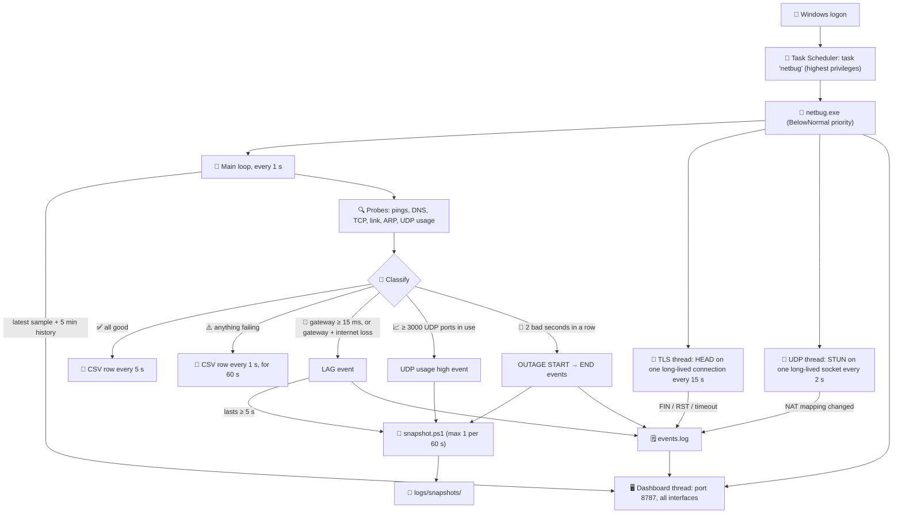

# 🐛 netbug

A tiny always-on Windows logger that catches **intermittent network drops** the moment they happen and records enough evidence to say *where* the problem is.

Built to hunt a 2-year-old bug on a wired hostel connection: Windows 11, a USB-C RTL8153 gigabit dongle, a MikroTik-gatewayed LAN, and TM Unifi upstream.

---

## 😩 The problem

Every few days, out of nowhere:

1. 🎙️ Discord voice ping jumps to **5000 ms**. Friends can't hear you, but you still hear them, so outbound traffic is dying while inbound still flows.
2. 🔄 About 20 s later, Discord spins forever and Valorant rubberbands, then disconnects.
3. 🔌 Replugging the cable shows **"connected, no internet"**.
4. ⏳ Minutes later it fixes itself and runs at full gigabit again.

Nothing in Windows explains it. So netbug watches every layer and timestamps exactly what breaks first.

---

## ⚙️ How it works



---

## 🔍 What it checks

| ⏱️ Every | 🔍 Check | 🎯 Catches |
|---|---|---|
| 1 s | Ping gateway, `1.1.1.1`, `8.8.8.8` | LAN lag, internet loss |
| 1 s | Active interface, dongle link state, tx/rx packet counters | Cable/link drops, hotspot switch, one-way traffic |
| 2 s | DNS query to the router | Resolver stalls ("sites load forever") |
| 2 s | STUN over one long-lived UDP socket | UDP path loss, **NAT mapping changes** (what kills voice/game sessions) |
| 10 s (every 1 s after a failure) | TCP connect to `github.com:443` | New connections failing |
| 10 s | UDP ports per process, gateway MAC via ARP | Port leaks, gateway swap/spoof |
| 15 s | HEAD on one long-lived TLS connection | Connections silently killed (FIN / RST / timeout) |
| 5 min | Public IP | ISP / PPPoE reconnects |
| 1 h | Own RAM / handles / threads | Leaks (auto-restarts past limits) |

🚨 **Outage** = no interface, both internet pings, DNS, TCP or UDP failing **2 seconds in a row**. Gateway-only ping loss is ignored, because the router rate-limits ICMP.

---

## 🗒️ What gets logged

All output goes to `logs/`, which is gitignored and stays on the machine.

| 📄 File | 📋 Contents |
|---|---|
| `netbug-<date>.csv` | One row per 5 s (per 1 s around failures). Columns: interface, link, IP, gateway + MAC, ping/DNS/TCP/UDP times, NAT mapping, packet counters, UDP usage, public IP, failures |
| `events.log` | Human-readable timeline: `OUTAGE START/END`, `LAG`, link/interface changes, gateway MAC / public IP / NAT mapping changes, TCP connection deaths, high UDP usage, hourly `health:` lines |
| `snapshots/` | Full dump per incident: adapter counters, NCSI state, neighbors, ping/DNS/TCP probes, traceroute, UDP/TCP usage, recent system events, plus a 15 s `pktmon` packet capture |

🧹 Files older than **30 days** are deleted, and `logs/` is hard-capped at **500 MB**: the oldest snapshots go first, then the oldest CSVs.

---

## 🖥️ Live dashboard

Open `http://<laptop-ip>:8787/` from any device on the LAN (or `http://localhost:8787/` on the laptop itself).

- Big status line: healthy, lagging, down, or "netbug isn't answering", plus the last finished outage or lag
- 5-minute trace of gateway, Cloudflare and UDP round-trip times, with a band on every second that had a failure
- Latest readings for every probe: interface, IPs, gateway MAC, NAT mapping, packet counts, UDP port usage
- `events.log` scrolling live. Health lines are hidden unless you tick the box, and it stops following if you scroll up.

Pure black for AMOLED, white text, SF Pro on Apple devices and Inter (`tools/fonts/inter.woff2`, served by netbug) everywhere else. It lays out for desktop, tablet and phone.

The page is read-only and makes no external requests, so it keeps working while the internet is down. It polls only while the tab is visible: `/api/state` every 1 s (only new samples, ~0.4 KB) and `/api/events` every 2 s (only new lines). Each request costs netbug ~0.15 ms of CPU; with no tab open the dashboard costs nothing. `tools/dashboard.html` is read from disk on every request, so editing it doesn't need a rebuild.

> ⚠️ Anyone on the LAN can see what the page shows, including your public IP, the gateway MAC and process names.

---

## 🪶 Footprint

| | |
|---|---|
| 🧠 RAM | ~25–37 MB |
| ⚡ CPU | ~1% of one core (≈0.07% of a 16-thread CPU), BelowNormal priority |
| 🌐 Network | ~0.75 KB/s total, no traffic to game or voice servers. The dashboard adds under 1 KB/s per open tab, on the LAN only. |
| 💾 Disk | ~6 MB/day of small appends |
| 🛡️ Safety | Restarts itself past 200 MB private memory, 5000 handles or 100 threads |

---

## 🛠️ Build & install

```powershell
# build (uses the C# compiler that ships with Windows)
C:\Windows\Microsoft.NET\Framework64\v4.0.30319\csc.exe /nologo /target:winexe /optimize /out:tools\netbug.exe tools\netbug.cs

# then, in an admin PowerShell, register tools\netbug.exe as a scheduled task:
#   trigger: at logon · run with highest privileges · no time limit · restart on failure
```

Admin rights are needed for two things: the snapshot's `pktmon` packet captures, and serving the dashboard on all interfaces (`http://+:8787/`).

---

## 📦 Repo layout

| 📄 Path | 📋 What |
|---|---|
| `tools/netbug.cs` | The logger |
| `tools/snapshot.ps1` | Incident snapshot, launched by netbug |
| `tools/dashboard.html` | Live dashboard page, served by netbug on port 8787 |
| `tools/fonts/` | Inter font for the dashboard (SIL Open Font License, `OFL.txt`) |
| `tools/redact.ps1` | Builds `REDACTED_<name>.md` from gitignored notes: MACs + terms in `redact.local.txt` → `xxx`, refuses to write if any PII remains |
| `REDACTED_NETWORK_SCAN.md` | 🔒 Public, redacted copy of the full network scan and findings |
| `CHANGELOG.md` | 📜 Every change, timestamped in MYT (UTC+08:00) |
| `AGENTS.md` | 📏 Rules for anyone (or any AI agent) working on this repo |
