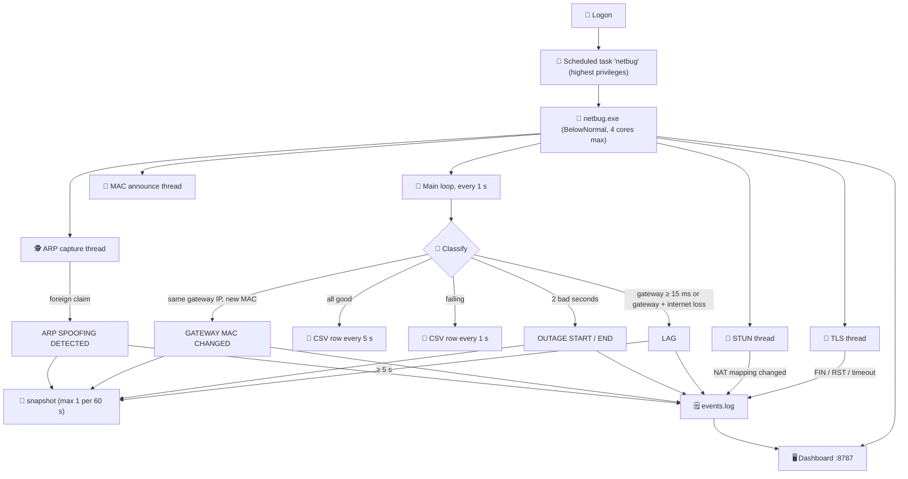

# 🐛 netbug

A small always-on Windows tool that catches **intermittent network drops** the moment they happen, records enough evidence to say *where* the problem is, and protects the laptop against **ARP spoofing** on a shared LAN.

---

## 🎯 Why it exists

On a wired hostel connection (Windows 11, a USB-C RTL8153 dongle, a MikroTik-gatewayed LAN, TM Unifi upstream), roughly once every 4 days:

1. 🎙️ Discord voice ping jumps to **5000 ms**: friends can't hear you, but you still hear them.
2. 🔄 About 20 s later Discord spins and Valorant rubberbands, then disconnects.
3. 🌫️ The **whole internet hangs** without an error page.
4. 🔌 Replugging the cable shows **"connected, no internet"**.
5. ⏳ Minutes later it fixes itself.

Nothing in Windows explained it, so netbug watches every layer and timestamps what breaks first.

> 🎯 **Found it (2026-10-28 05:34, and again 15:28 from the same device):** another device on the hostel LAN was **ARP spoofing the gateway**. It told the laptop "I'm the router", then swallowed every packet. netbug caught the gateway MAC change, the outage and the spoofed ARP replies live.
> - Write-up: [`REDACTED_INCIDENT_2026-10-28_ARP_SPOOFING.md`](REDACTED_INCIDENT_2026-10-28_ARP_SPOOFING.md)
> - Report for the hostel: [`REDACTED_RCC_REPORT.md`](REDACTED_RCC_REPORT.md)
> - 🎬 Narrated explainer (2:22): [`video/incident-v4-redacted.mp4`](video/incident-v4-redacted.mp4)

---

## 🚀 Setup

### Requirements

- Windows 10 2004+ or Windows 11 (for `pktmon`)
- Admin rights (packet captures, ARP entries, the dashboard on port 8787)
- Nothing to install: it builds with the C# compiler that ships with Windows (.NET Framework 4.x)

### 1. Build

In PowerShell, from the repo folder:

```powershell
cd tools
C:\Windows\Microsoft.NET\Framework64\v4.0.30319\csc.exe /nologo /target:winexe /optimize /out:netbug.exe `
  /resource:dashboard.html,netbug.dashboard.html /resource:fonts\inter.woff2,netbug.inter.woff2 `
  /resource:arpwatch.ps1,netbug.arpwatch.ps1 /resource:snapshot.ps1,netbug.snapshot.ps1 netbug.cs
cd ..
```

This makes `tools\netbug.exe`, with the dashboard page, font and scripts embedded in it.

### 2. Start it at every logon

In an **admin** PowerShell, from the repo folder:

```powershell
$tools = "$PWD\tools"
Register-ScheduledTask netbug `
  -Action    (New-ScheduledTaskAction -Execute "$tools\netbug.exe" -WorkingDirectory $tools) `
  -Trigger   (New-ScheduledTaskTrigger -AtLogOn -User $env:USERNAME) `
  -Principal (New-ScheduledTaskPrincipal -UserId $env:USERNAME -LogonType Interactive -RunLevel Highest) `
  -Settings  (New-ScheduledTaskSettingsSet -ExecutionTimeLimit ([TimeSpan]::Zero) -RestartCount 999 `
              -RestartInterval (New-TimeSpan -Minutes 1) -AllowStartIfOnBatteries -DontStopIfGoingOnBatteries `
              -MultipleInstances IgnoreNew)
Start-ScheduledTask netbug
```

### 3. Open the dashboard

Go to **http://localhost:8787/** on the laptop. Logs land in `logs\` (gitignored).

### 4. Protect the laptop

In the dashboard's **Router protection** panel:

1. Click **Check now** (the connection drops for a few seconds while it tests).
2. When it names the real router, turn on **Pin it permanently**.
3. Leave **Keep the router updated** on (it is by default).

### Updating

The running exe can't be overwritten, so in an admin PowerShell:

```powershell
Stop-ScheduledTask netbug; Get-Process netbug -ErrorAction SilentlyContinue | Stop-Process -Force
# rebuild (step 1), then:
Start-ScheduledTask netbug
```

`tools\dashboard.html` is read from disk on every request, so page edits need no rebuild.

### Uninstalling

In an admin PowerShell:

```powershell
Stop-ScheduledTask netbug; Get-Process netbug -ErrorAction SilentlyContinue | Stop-Process -Force
Unregister-ScheduledTask netbug -Confirm:$false
pktmon stop
```

Turn off the pin first in the dashboard, or remove it by hand (see [Pinning by hand](#-pinning-by-hand)).

---

## 🤝 Sending netbug to a friend

`tools\netbug.exe` is self-contained. Send **only the exe** (zip it if the chat app blocks `.exe`):

1. They double-click it and accept the admin prompt (UAC).
2. Their browser opens `http://localhost:8787/`.
3. In **Router protection**: **Check now** (or turn on **Auto-detect**), then **Pin it permanently**.

A lone exe (no `dashboard.html` next to it) runs in **portable mode**:
- files and logs go to `C:\ProgramData\netbug`
- the page is served on localhost only
- the panel has a **Stop netbug** button
- it doesn't start at logon, but the pin stays after a restart

Running it again while it runs just opens the page.

> ⚠️ The exe isn't code-signed: SmartScreen may say "Windows protected your PC" (More info → Run anyway), and some antivirus tools may flag a program that asks for admin and runs `netsh` and `pktmon`.

---

## 🛡️ Router protection

The panel only appears on the laptop itself (`http://localhost:8787/`).

| Control | What it does |
|---|---|
| **Check now** | Finds the real router MAC. Candidates: the ARP entry, any pin, and every MAC that answers for the gateway IP during 10 s of the ARP capture (the laptop asks for the router meanwhile, unless pinned). Each is set briefly as a temporary static ARP entry: it's the real router when internet pings pass **and** a TTL-1 ping comes back "TTL expired" from the gateway IP itself. The entry is then put back. |
| **Auto-detect the real router** | Runs a check now, every 30 min, when the gateway changes, and after a spoofing alert (at most every 5 min). It never changes a pin by itself. |
| **Pin it permanently** | Pins the verified MAC (`netsh … store=persistent`), so Windows ignores fake "I am the router" replies, even after a restart. Turn it off before using the same adapter on another network with the same router address. |
| **Keep the router updated** (on by default) | The pin only protects the laptop's own table. An attacker can still tell the *router* that the laptop's IP is their MAC. About once a second netbug makes Windows send a fresh ARP request (a broadcast carrying the laptop's real IP and MAC), so the router corrects a fake entry within about a second. The panel shows how many were sent and how many the capture saw on the wire. |

Limits: a router that ignores unrequested ARP isn't helped by the announce, and a fake claim sent only to the router never reaches the laptop. The real fix is on the hostel's switch (DHCP snooping + Dynamic ARP Inspection).

The control API (`/api/fix…`) only accepts requests from loopback, with a `Host` of `localhost`/`127.0.0.1` (blocks DNS rebinding) and the per-run token the page got (`X-Netbug-Token`). Other websites can't read the token or send that header.

### 📌 Pinning by hand

```powershell
netsh interface ipv4 add neighbors "<adapter name>" <gateway ip> <real gateway mac> store=persistent   # pin
netsh interface ipv4 delete neighbors "<adapter name>" <gateway ip>                                     # unpin
```

If the gateway stops answering while pinned (for example the router was replaced), the outage event says the pin may be stale and prints the unpin command.

---

## 🔍 What it checks

| ⏱️ Every | 🔍 Check | 🎯 Catches |
|---|---|---|
| 1 s | Ping gateway, `1.1.1.1`, `8.8.8.8`; tx/rx packet counters | LAN lag, internet loss, one-way traffic |
| On Windows network events, 1 s while failing, else 10 s | Active interface, dongle link state | Cable/link drops, hotspot switch |
| 2 s (1 s after a failure) | DNS query to the router | Resolver stalls ("sites load forever") |
| 2 s | STUN on one long-lived UDP socket | UDP loss, **NAT mapping changes** (what kills voice/game sessions) |
| 10 s (1 s after a failure) | TCP connect to `github.com:443` | New connections failing |
| 10 s | UDP ports per process; gateway MAC and ARP entry type (static = pinned) | Port leaks, **gateway MAC change** (alert + snapshot), pin removed |
| Always (read every 60 s, judged every 5 min and at each snapshot) | ARP-only `pktmon` capture, last 15 min kept in memory | **Any other device claiming the gateway IP or this laptop's IP** = `ARP SPOOFING DETECTED` |
| ~1 s | MAC announce (see Router protection) | Not a check: keeps the router's entry for this laptop correct |
| 15 s | HEAD on one long-lived TLS connection | Connections silently killed (FIN / RST / timeout) |
| 5 min | Public IP | ISP / PPPoE reconnects |
| 1 h | Own RAM / handles / threads | Leaks (restarts itself past limits) |

🚨 **Outage** = no interface, or both internet pings, DNS, TCP or UDP failing **2 seconds in a row**. Gateway-only ping loss doesn't count (the router rate-limits ICMP).



---

## 🗒️ Logs

Everything goes to `logs\` (gitignored; `C:\ProgramData\netbug\logs` in portable mode).

| File | Contents |
|---|---|
| `netbug-<date>.csv` | One row per 5 s (per 1 s around failures): interface, link, IP, gateway + MAC + ARP entry type, ping/DNS/TCP/UDP times, NAT mapping, packet counters, UDP usage, public IP, failures |
| `events.log` | Timeline: `OUTAGE START/END`, `LAG`, `GATEWAY MAC CHANGED`, `ARP SPOOFING DETECTED`, link/interface/MAC/pin/public IP/NAT changes, TCP connection deaths, high UDP usage, hourly `health:` lines |
| `snapshots\` | Per incident: adapters, NCSI, neighbors, ping/DNS/TCP probes, traceroute, UDP/TCP usage, system events, a `pktmon` capture taken while the probes run, who claimed the gateway or this laptop in it, and `<name>.ring.txt` (the ARP about the gateway or this laptop from the 15 min before) |
| `netbug.settings` | The Auto-detect and Keep-the-router-updated switches |

🧹 Files older than **30 days** are deleted, and `logs\` is capped at **500 MB** (oldest snapshots first, then oldest CSVs).

---

## 🖥️ Dashboard

`http://localhost:8787/` on the laptop, or `http://<laptop-ip>:8787/` from any device on the LAN (also over Tailscale, if the phone and laptop have a direct path).

- Status line: healthy, lagging (orange), down (red), **possible ARP spoofing** (red, 30 min after an alert), plus the last outage or lag
- 5-minute chart of gateway, Cloudflare and UDP round-trip times, with outages and lag shaded
- A lost Cloudflare ping is hidden while Google still answers: Cloudflare drops some pings on its own (rate limiting), so the readout keeps the last value and the line doesn't break. The CSV still logs it as `-1`.
- Latest readings: interface, IPs, gateway MAC with pin status and the last ARP watch result, NAT mapping, packets, UDP ports
- `events.log` live (alerts red, lag orange, hourly health lines cyan and hideable)

The page makes no external requests, so it works while the internet is down. It polls only while visible (`/api/state` 1 s, `/api/events` 2 s, `/api/fix` 2 s on the laptop).

> ⚠️ Anyone on the LAN can see the page, including your public IP, the gateway MAC and process names. The Router protection controls are localhost-only.

---

## 🪶 Footprint

| | |
|---|---|
| 🧠 RAM | ~25–45 MB for netbug, plus **512 MB of kernel memory** that `pktmon` reserves while the ARP capture runs (not adjustable) |
| ⚡ CPU | ~1% of one core, BelowNormal priority, locked to the 4 highest-numbered logical processors (child processes too), so games keep the rest |
| 🌐 Network | ~0.75 KB/s plus one 42-byte ARP broadcast per second; nothing to game or voice servers. The dashboard adds under 1 KB/s per open tab, LAN only |
| 💾 Disk | ~3–4 MB/day |
| 🛡️ Safety | Restarts itself past 200 MB private memory, 5000 handles or 100 threads |

---

## 📦 Repo layout

| Path | What |
|---|---|
| `tools/netbug.cs` | The program |
| `tools/dashboard.html` | Dashboard page (with the Router protection panel on the laptop) |
| `tools/snapshot.ps1` | Incident snapshot, run by netbug |
| `tools/arpwatch.ps1` | Reads a snapshot's capture file: who claimed the gateway IP or this laptop's IP |
| `tools/fonts/` | Inter font for the dashboard (SIL Open Font License, `OFL.txt`) |
| `tools/redact.ps1` | Builds `REDACTED_<name>.md` from gitignored notes (MACs + terms in `redact.local.txt` → `xxx`); refuses to write if PII remains |
| `REDACTED_INCIDENT_2026-10-28_ARP_SPOOFING.md` | 🔒 Incident report: the ARP spoofing attacks, evidence, mitigation |
| `REDACTED_RCC_REPORT.md` | 🔒 Report for the hostel RCC: who to look for and how to stop it |
| `REDACTED_NETWORK_SCAN.md` | 🔒 Network scan and findings |
| `video/` | 🎬 Narrated explainer (2:22) of both attacks and the fix; see `video/README.md` |
| `CHANGELOG.md` | 📜 Every change, timestamped in MYT (UTC+08:00) |
| `AGENTS.md` | 📏 Rules for anyone (or any AI agent) working on this repo |
