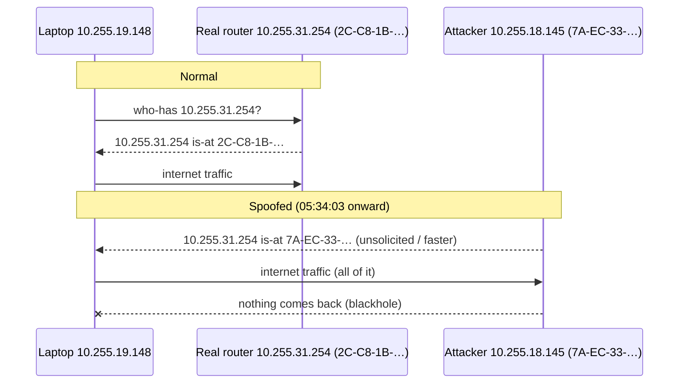

# Incident report: ARP spoofing of the hostel gateway (2026-10-28 05:34)

All times are MYT (UTC+08:00), the laptop's system clock. Evidence files live in `logs/` on the laptop (gitignored):
- `logs/events.log`
- `logs/netbug-2026-10-28-old-*.csv` (CSV rows from before the 05:53 column change)
- `logs/snapshots/2026-10-28_05-34-06_outage.txt` / `.etl` / `.pkt.txt`

---

## 1. Summary

At **05:34:03** another device on the hostel LAN started answering ARP for the gateway address `10.255.31.254` with its own MAC, **`xx-xx-xx-xx-xx-xx`**. The same device also holds **`10.255.18.145`**.

The laptop believed it, and from then on sent every outgoing packet to that device instead of the hostel MikroTik (`xx-xx-xx-xx-xx-xx`). The device **never forwarded or answered any of them**, so the laptop was completely cut off for **150 s**, until the user unplugged Ethernet at 05:36:35 and Windows moved to Wi-Fi.

Other machines on the LAN were asking for the gateway at the same moment, so the attack was not aimed at this laptop alone.

This is **ARP spoofing / ARP cache poisoning**. It is what tools like NetCut, arpspoof, Bettercap or "WiFiKill" do, and it is common on flat hostel and campus LANs. It explains the symptom pattern the user has had for ~2 years (§6).

**Response:**
- The gateway's MAC is now **pinned** on the laptop (a static ARP entry), so Windows ignores spoofed replies (§8).
- netbug now raises an alert for a changed gateway MAC, shows whether the gateway is pinned, and runs a periodic ARP watch that detects spoofing even while the pin protects the laptop (§9).
- A write-up for the hostel RCC is in `RCC_REPORT.md` (§10).

---

## 2. Background: what ARP spoofing is

On an Ethernet LAN, IP addresses are delivered by MAC address. A PC that wants to send to the router (`10.255.31.254`) first asks the whole LAN, by broadcast: *"who has 10.255.31.254?"* Whoever owns that IP replies *"10.255.31.254 is at <my MAC>"*. The PC caches the answer and sends all internet-bound traffic to that MAC.

ARP has **no authentication**. Any device can send *"10.255.31.254 is at <MY MAC>"*, unasked, as often as it likes, and most operating systems accept the newest answer.



What happens next depends on the attacker:
- **Cut mode (seen here):** drop everything, so the victim is offline.
- **Throttle mode:** forward slowly or drop part of the traffic, so the victim gets lag, high ping and one-way audio.
- **Man-in-the-middle:** forward everything while reading it.

---

## 3. What the user saw (05:35, during the outage)

Three screenshots taken by the user during the outage (not committed; described here):

1. **Claude Code** (this session) stuck on *"Waiting for API response · will retry in 1m 58s · check your network"*, while a dashboard stress test had just finished.
2. **05:35:14**: Brave showing *"This site can't be reached. console.tailscale.com's DNS address could not be found. DNS_PROBE_POSSIBLE"*. The user was only browsing the Tailscale website; Tailscale is not installed and played no part.
3. **05:35:34**: the netbug dashboard at `localhost:8787` showing:
   - **"Connection is down"**: *"Failing: gateway ping, internet ping, DNS, UDP, new TCP connections, local lag. Ongoing for 1 min 28 s."*
   - all six readouts (Gateway, Cloudflare, Google, UDP, DNS, New TCP) **lost**
   - Interface `Ethernet 7`, USB Ethernet link **up**, Gateway `10.255.31.254`, **Gateway MAC `xx-xx-xx-xx-xx-xx`**
   - Packets in the last second: **52 sent, 1 received**

The link was up and Windows still listed the network, yet nothing worked. This is the same "connected but dead" state the user has seen for two years.

---

## 4. Timeline (netbug CSV + events.log)

CSV rows were written every 1-3 s during the failure (probes were timing out). `gw_mac` comes from the ARP cache every 10 s.

| Time | gw_mac | gw ms | 1.1.1.1 ms | 8.8.8.8 ms | DNS ms | new TCP ms | UDP (STUN) ms | tx/rx pkts per s | What it means |
|---|---|---|---|---|---|---|---|---|---|
| 05:34:00 | xx-xx-xx-xx-xx-xx | 0 | 9 | 2 | 15 | 8 | 10 | 29/32 | Healthy. Real MikroTik. |
| **05:34:03** | | | | | | | | | **events.log: `gateway MAC: xx-xx-xx-xx-xx-xx -> xx-xx-xx-xx-xx-xx`** |
| 05:34:04 | **xx-xx-xx-xx-xx-xx** | lost | lost | lost | 12 | 10 | 8 | 18/13 | All pings die at once. DNS/TCP/UDP values are still from before the switch. |
| 05:34:06 | 7A-EC-… | lost | lost | lost | **lost** | 10 | 8 | 31/**3** | `OUTAGE START [gw\|internet\|dns\|lag]`. Snapshot launched. |
| 05:34:07–12 | 7A-EC-… | lost | lost | lost | lost | 10 | 8 | 7–21 / 0–4 | Sending, almost nothing coming back. |
| 05:34:09 | | | | | | | | | `LAG ongoing for 6 s: … 4 lost gw pings` |
| 05:34:14 | | | | | | | | | The persistent TLS connection to google.com (516 s old, 34 requests) **dies: TIMEOUT**. |
| 05:34:19 | | | | | | | | | Reconnect fails: `socket HostNotFound` (DNS dead). |
| 05:34:20 | | | | | | | | | `outage now [gw\|internet\|dns\|udp\|tcp\|lag]`: **everything** is down, UDP and new TCP included. tx/rx 23/4. |
| 05:34:20–05:36:32 | 7A-EC-… | | | | | | | | TLS reconnects alternate between "connect timed out" and "HostNotFound" every 5 s. |
| 05:36:35 | | | | | | | | | **User unplugs Ethernet.** Link up to down, Wi-Fi takes over (`192.168.50.200`, gw `192.168.50.1`). |
| 05:36:36 | | | | | | | | | `OUTAGE END after 150 s`. |
| 05:36:45 | | | | | | | | | `LAG 05:34:04-05:36:35 (152 s): 52 bad s, … 52 lost gw pings` |

The UDP NAT mapping change at 05:36:35 (`…:56212 -> …:59340`) comes from moving to Wi-Fi. It is not part of the attack.

---

## 5. Packet-level evidence (snapshot taken at 05:34:07)

### 5.1 ARP / neighbor cache

```
InterfaceAlias IPAddress     LinkLayerAddress  State
Ethernet 7     10.255.31.254 xx-xx-xx-xx-xx-xx Probe
Ethernet 7     10.255.18.145 xx-xx-xx-xx-xx-xx Stale
```

The gateway IP and `10.255.18.145` resolve to the **same MAC**. A MAC is one network card, so the device at `10.255.18.145` is the one claiming to be the gateway. `Probe` means Windows was already suspicious and re-checking the entry.

### 5.2 Probes

- `ping 10.255.31.254 / 1.1.1.1 / 8.8.8.8 / xxx (ISP hop)`: **0/3** each
- `dns via gw: FAIL in 7086 ms`
- `tcp www.google.com:443 -> False`, `tcp discord.com:443 -> False`
- `tracert 1.1.1.1`: `* * *` from **hop 1**, so not even the "gateway" answered
- NCSI still said `IPv4Connectivity: Internet` (it had not re-probed yet), which is why Windows showed no warning
- adapter counters over 3 s: **+19 tx, +2 rx**, zero errors or discards. The NIC and driver were healthy and the packets were leaving.
- TCP states: **16 SynSent** (new connections getting no answer), 20 Established (stale)
- system log: DNS-Client 1014 at 05:34:14, "none of the configured DNS servers responded"

### 5.3 pktmon capture (05:34:54 – 05:35:09, filters: ARP, the gateway IP, 1.1.1.1)

pktmon logs each frame at two driver components, so raw counts are doubled. Unique frames:

| Frames | From → To | What |
|---|---|---|
| **71** | laptop `xx-xx-xx-xx-xx-xx` → `xx-xx-xx-xx-xx-xx` | All IPv4 to the "gateway": DNS queries (`bridge.claudeusercontent.com`, `sync-v2.brave.com`, `stun.l.google.com`, netbug's own `nb…example.com`), pings, TCP SYNs |
| **0** | anything → laptop (IPv4) | **Not one IPv4 packet came back.** The attacker swallowed everything (cut mode). |
| 2 | laptop → `7A-EC-…` (unicast) | Windows re-checking the cached entry: `who-has 10.255.31.254 (xx-xx-xx-xx-xx-xx) tell 10.255.19.148` |
| **2** | `xx-xx-xx-xx-xx-xx` → laptop (unicast) | **`Reply 10.255.31.254 is-at xx-xx-xx-xx-xx-xx`**, sent **0.33 ms** after each check (05:34:59.7497 → .7500, 05:35:06.2460 → .2464) |
| 0 | `xx-xx-xx-xx-xx-xx` (real MikroTik) | The real router does not appear even once. |
| 5 | `xx-xx-xx-xx-xx-xx` (`10.255.23.47`) → broadcast | `who-has 10.255.31.254 tell 10.255.23.47`, repeated every ~1 s: **another resident's device had lost the gateway too** |
| 1 | `xx-xx-xx-xx-xx-xx` (`10.255.22.125`) → broadcast | `who-has 10.255.31.254`: a third device looking for the gateway |
| 2 | `xx-xx-xx-xx-xx-xx` (`10.255.23.103`) → broadcast | ordinary ARP for `10.255.21.16`: background noise |

The capture also showed `192.168.137.x` ARP on the laptop's own Windows Mobile Hotspot (Wi-Fi Direct virtual adapter). That's unrelated local traffic.

### 5.4 Why this is spoofing and not a router fault

- A router fault would not hand out a **different MAC**. A dead router simply stops answering ARP, and netbug would log `arp_fail`, as it did during the 04:34 unplug test.
- The replying MAC is **locally administered**: the `2` bit of the first byte is set (`7A` = `0111 1010`). The real gateway's MAC has a registered vendor (`2C-C8-1B` = Routerboard.com / MikroTik). Locally administered MACs come from phones and laptops using MAC randomization, from VMs, or from spoofing tools.
- That MAC also owns an ordinary client address (`10.255.18.145`).
- Its replies were **unicast to this laptop**, the signature of a tool that targets victims one by one.
- It **dropped 100%** of the traffic it attracted, which is the "cut" function of NetCut-style tools.
- Several other hosts lost the gateway at the same moment.

It could still be a badly misconfigured device (for example a phone or PC sharing its connection with a bridge or proxy-ARP setup). The effect on the LAN is the same either way, and only the hostel admins can see which room or port it's on.

---

## 6. How this explains the 2-year history

| Long-standing symptom | Explanation |
|---|---|
| Every few days, Discord jumps to 5000 ms; **friends can't hear the user, but the user still hears them** | The attacker poisons only the victim's view of the gateway. **Outbound** traffic goes to the attacker and is dropped or throttled. **Inbound** traffic from the internet still arrives directly from the real router, which still knows the laptop's real MAC. So the user hears, but isn't heard. |
| ~20 s later Discord spins forever and Valorant rubberbands, then disconnects | Once outbound has been dead long enough, TCP and UDP sessions time out (here the TLS probe died after ~10 s and UDP after ~16 s). |
| Unplug and replug gives **"connected, no internet"** | Replugging clears the ARP cache. The laptop asks "who-has gateway" again and the attacker, still running, answers first or re-poisons within seconds. |
| Recovers "by itself" after some minutes | The attacker stops, or the real router's ARP traffic wins again. |
| **Other residents are affected at the same time** | The tool targets several or all hosts on the flat `/20` (§5.3: other hosts were asking for the gateway). |
| Windows shows nothing wrong: link up, no driver or DHCP events | Nothing is wrong locally. The laptop is sending perfectly to the wrong MAC. |
| 10-24 03:13: Discord voice heartbeat timeout with **no Windows event at all** | Consistent with the same thing (no gateway MAC history existed then to prove it). |

Earlier suspects, now explained or ruled out:
- the USB dongle and driver: the NIC sent fine, with zero errors
- power saving
- UDP port exhaustion: unrelated times
- "the MikroTik DNS dies": DNS failed only because the DNS server is the gateway IP, which was hijacked

---

## 7. Who did it

| | |
|---|---|
| Attacker MAC | `xx-xx-xx-xx-xx-xx` (locally administered/randomized, so no vendor lookup possible) |
| Attacker IP | `10.255.18.145` (from the same MAC in the laptop's neighbor cache) |
| Active | at least 05:34:03 – 05:36:35 on 2026-10-28 (the laptop left the LAN at 05:36:35) |
| Behaviour | unicast ARP replies claiming `10.255.31.254`; dropped all forwarded traffic |

The laptop can't see which room this is. The hostel MikroTik can:
- the DHCP lease for `10.255.18.145`, which may include a hostname
- the bridge host table, which gives the switch port or AP for `xx-xx-xx-xx-xx-xx`

A randomized MAC can change, but it usually stays the same per Wi-Fi network on phones and Windows. See `RCC_REPORT.md`.

---

## 8. Mitigation applied on the laptop: gateway MAC pinned

**Machine change, approved by the user, 2026-10-28 05:50:**

```
netsh interface ipv4 add neighbors "Ethernet 7" 10.255.31.254 xx-xx-xx-xx-xx-xx store=persistent
```

Result (`Get-NetNeighbor`):

```
10.255.31.254  xx-xx-xx-xx-xx-xx  Permanent      (active store and PersistentStore)
```

**What it does:**
- Windows never overwrites a static (Permanent) ARP entry, so spoofed *"10.255.31.254 is-at <someone else>"* replies are ignored.
- The laptop's **outbound** traffic always goes to the real MikroTik.
- It survives reboots and replugging.

**What it does not do:**
- If the attacker also poisons the **router's** entry for the laptop (two-way spoofing), **inbound** traffic can still be diverted. Only the hostel can fix that side (§10). netbug will still show it: the gateway stays pinned, but traffic dies and arpwatch reports the attacker.
- The pin is tied to the adapter name **`Ethernet 7`**. If the dongle is moved to another USB port and Windows names it "Ethernet 8", the pin doesn't apply there. netbug then logs `gateway ARP entry … -> dynamic` and the dashboard says "Learned (dynamic ARP entry, can be spoofed)". Re-run the command with the new name.
- It only covers the hostel gateway IP `10.255.31.254`. Other networks are unaffected.

**Risk:** if the hostel ever **replaces the MikroTik** (new MAC), the laptop loses internet on the hostel LAN until the pin is removed. netbug makes this obvious:
- `OUTAGE START … gw_arp=static`, followed by the line *"gateway is pinned to xx-xx-xx-xx-xx-xx: if the hostel replaced its router, the pin is stale (remove it: netsh …)"*
- the dashboard's Gateway MAC cell says "Pinned (static ARP entry)"

**Remove the pin** (admin PowerShell or cmd):

```
netsh interface ipv4 delete neighbors "Ethernet 7" 10.255.31.254
```

---

## 9. netbug changes made because of this incident

| Feature | What it does |
|---|---|
| **Gateway MAC change alert** | If the gateway IP stays the same but its MAC changes from one real MAC to another, netbug logs `GATEWAY MAC CHANGED, possible ARP spoofing: <gw> <old> -> <new> (ARP entry <type>)` and takes a snapshot immediately. The dashboard turns red with **"Possible ARP spoofing"** for 30 min. Interface switches (new gateway IP) and `arp_fail` don't trigger it. |
| **Pin status** (`gw_arp`) | Every 10 s netbug reads the gateway's entry type from the Windows ARP table (`GetIpNetTable`): `static` = pinned, `dynamic` = learned. It's a new CSV column, `gateway ARP entry … -> …` events are logged on change, and the dashboard shows it under Gateway MAC. |
| **Stale-pin hint** | An outage where the gateway itself is unreachable while pinned adds the "pin may be stale" line with the exact removal command. |
| **ARP watch** (`tools/arpwatch.ps1`) | Every 5 min: a 10 s ARP-only pktmon capture at the NIC driver. That's **below** the layer where Windows ignores spoofed replies, so attacks stay visible while the pin protects the laptop. Every MAC that claimed the gateway IP is counted. Any MAC other than the known gateway MAC gives `ARP SPOOFING DETECTED: gateway <ip> claimed by <mac> xN …`, a snapshot and the red dashboard alert. A clean result shows as "ARP watch: clean at HH:MM". It is skipped for 90 s after a snapshot so the two pktmon sessions don't collide. |
| **Snapshot ARP analysis** | Every snapshot capture now ends with "who claimed to be the gateway" (same rule as arpwatch). The neighbor table now includes the gateway's Permanent (pinned) entry. |
| **Dashboard** | The headline is colored by state (red down/alert, orange lag). Outage bands are stronger and have a solid colored strip on top. Spoofing and gateway-change lines are red in the event log. |

Verified on the laptop after the change:
- arpwatch run by hand: 11 s, only the real gateway seen, temp files removed
- netbug logged `gateway ARP entry … -> dynamic` (Wi-Fi) and wrote the new `gw_arp` CSV column

---

## 10. What the hostel should do (summary of `RCC_REPORT.md`)

1. Find `10.255.18.145` / `xx-xx-xx-xx-xx-xx` in the MikroTik DHCP leases and bridge host table, then locate the port or AP and the room.
2. Protect the gateway's ARP on the LAN, for example:
   - DHCP-only ARP: `arp=reply-only` on the LAN bridge, with **add-arp-for-leases** on the DHCP server. The router then trusts only leases it handed out.
   - DHCP snooping plus ARP inspection on managed switches, if they support it.
   - **client isolation** on APs and switch ports, so residents can't send frames to each other at all
3. Watch for repeat offenders (the same MAC or IP claiming `10.255.31.254`).
