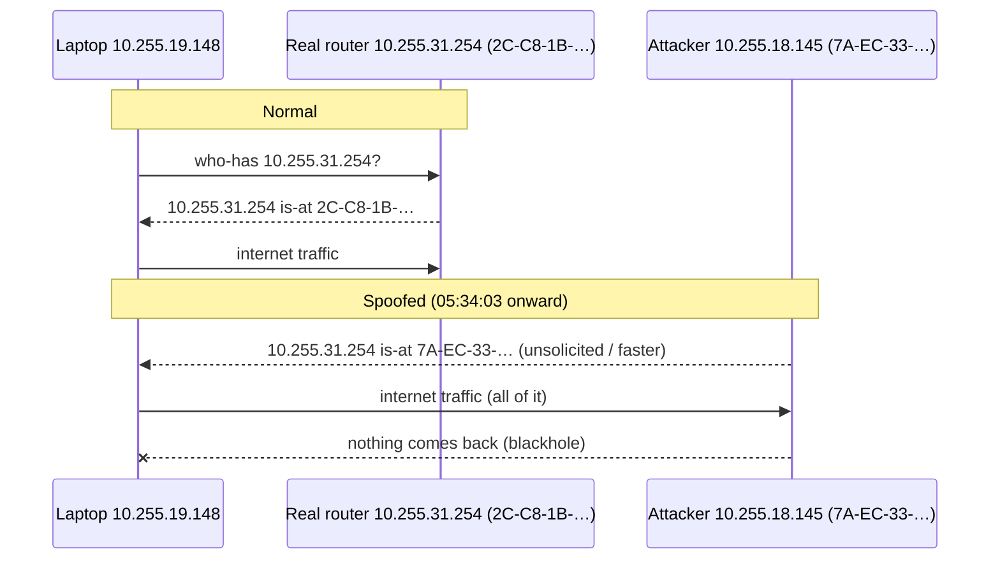

# Incident report: ARP spoofing of the hostel gateway (2026-10-28 05:34)

All times are MYT (UTC+08:00), the laptop's system clock. Evidence files live in the laptop's netbug logs (gitignored): `C:\ProgramData\netbug\logs` since 2026-11-04 (the release exe; the earlier history was copied there from the repo's `logs/`):
- `logs/events.log`
- `logs/netbug-2026-10-28-old-*.csv` (CSV rows from before the 05:53 column change)
- `logs/snapshots/2026-10-28_05-34-06_outage.txt` / `.etl` / `.pkt.txt`

---

## 1. Summary

At **05:34:03** another device on the hostel LAN started answering ARP for the gateway address `10.255.31.254` with its own MAC, **`xx-xx-xx-xx-xx-xx`**. The same device also holds **`10.255.18.145`**.

The laptop believed it, and from then on sent every outgoing packet to that device instead of the hostel MikroTik (`xx-xx-xx-xx-xx-xx`). The device **never forwarded or answered any of them**, so the laptop was completely cut off for **150 s**, until the user unplugged Ethernet at 05:36:35 and Windows moved to Wi-Fi.

Other machines on the LAN were asking for the gateway at the same moment, so the attack was not aimed at this laptop alone.

This is **ARP spoofing / ARP cache poisoning**. It is what tools like NetCut, arpspoof, Bettercap or "WiFiKill" do, and it is common on flat hostel and campus LANs. It explains the symptom pattern the user has had for ~2 years (§6).

**It happened again at 15:28 the same day, from the same device, and it is confirmed as the same issue (§11).**

**Response:**
- The gateway's MAC was **pinned** on the laptop (a static ARP entry) at 05:50, **removed at 15:12** at the user's request so the next drop could confirm the cause, and **re-applied at 15:37** after the 15:28 attack confirmed it (§8, §11).
- netbug now raises an alert for a changed gateway MAC, shows whether the gateway is pinned, and runs a periodic ARP watch that detects spoofing even while the pin protects the laptop (§9).
- A write-up for the hostel RCC is in `RCC_REPORT.md` (§10).

---

## 2. Background: what ARP spoofing is

On an Ethernet LAN, IP addresses are delivered by MAC address. A PC that wants to send to the router (`10.255.31.254`) first asks the whole LAN, by broadcast: *"who has 10.255.31.254?"* Whoever owns that IP replies *"10.255.31.254 is at <my MAC>"*. The PC caches the answer and sends all internet-bound traffic to that MAC.

ARP has **no authentication**. Any device can send *"10.255.31.254 is at <MY MAC>"*, unasked, as often as it likes, and most operating systems accept the newest answer.



What happens next depends on the attacker:
- **Cut mode (seen here):** drop everything, so the victim is offline.
- **Throttle mode:** forward slowly or drop part of the traffic, so the victim gets lag, high ping and one-way audio.
- **Man-in-the-middle:** forward everything while reading it.

---

## 3. What the user saw (05:35, during the outage)

Three screenshots taken by the user during the outage (not committed; described here):

1. **Claude Code** (this session) stuck on *"Waiting for API response · will retry in 1m 58s · check your network"*, while a dashboard stress test had just finished.
2. **05:35:14**: Brave showing *"This site can't be reached. console.tailscale.com's DNS address could not be found. DNS_PROBE_POSSIBLE"*. The user was only browsing the Tailscale website; Tailscale is not installed and played no part.
3. **05:35:34**: the netbug dashboard at `localhost:8787` showing:
   - **"Connection is down"**: *"Failing: gateway ping, internet ping, DNS, UDP, new TCP connections, local lag. Ongoing for 1 min 28 s."*
   - all six readouts (Gateway, Cloudflare, Google, UDP, DNS, New TCP) **lost**
   - Interface `Ethernet 7`, USB Ethernet link **up**, Gateway `10.255.31.254`, **Gateway MAC `xx-xx-xx-xx-xx-xx`**
   - Packets in the last second: **52 sent, 1 received**

The link was up and Windows still listed the network, yet nothing worked. This is the same "connected but dead" state the user has seen for two years.

---

## 4. Timeline (netbug CSV + events.log)

CSV rows were written every 1-3 s during the failure (probes were timing out). `gw_mac` comes from the ARP cache every 10 s.

| Time | gw_mac | gw ms | 1.1.1.1 ms | 8.8.8.8 ms | DNS ms | new TCP ms | UDP (STUN) ms | tx/rx pkts per s | What it means |
|---|---|---|---|---|---|---|---|---|---|
| 05:34:00 | xx-xx-xx-xx-xx-xx | 0 | 9 | 2 | 15 | 8 | 10 | 29/32 | Healthy. Real MikroTik. |
| **05:34:03** | | | | | | | | | **events.log: `gateway MAC: xx-xx-xx-xx-xx-xx -> xx-xx-xx-xx-xx-xx`** |
| 05:34:04 | **xx-xx-xx-xx-xx-xx** | lost | lost | lost | 12 | 10 | 8 | 18/13 | All pings die at once. DNS/TCP/UDP values are still from before the switch. |
| 05:34:06 | 7A-EC-… | lost | lost | lost | **lost** | 10 | 8 | 31/**3** | `OUTAGE START [gw\|internet\|dns\|lag]`. Snapshot launched. |
| 05:34:07–12 | 7A-EC-… | lost | lost | lost | lost | 10 | 8 | 7–21 / 0–4 | Sending, almost nothing coming back. |
| 05:34:09 | | | | | | | | | `LAG ongoing for 6 s: … 4 lost gw pings` |
| 05:34:14 | | | | | | | | | The persistent TLS connection to google.com (516 s old, 34 requests) **dies: TIMEOUT**. |
| 05:34:19 | | | | | | | | | Reconnect fails: `socket HostNotFound` (DNS dead). |
| 05:34:20 | | | | | | | | | `outage now [gw\|internet\|dns\|udp\|tcp\|lag]`: **everything** is down, UDP and new TCP included. tx/rx 23/4. |
| 05:34:20–05:36:32 | 7A-EC-… | | | | | | | | TLS reconnects alternate between "connect timed out" and "HostNotFound" every 5 s. |
| 05:36:35 | | | | | | | | | **User unplugs Ethernet.** Link up to down, Wi-Fi takes over (`192.168.50.200`, gw `192.168.50.1`). |
| 05:36:36 | | | | | | | | | `OUTAGE END after 150 s`. |
| 05:36:45 | | | | | | | | | `LAG 05:34:04-05:36:35 (152 s): 52 bad s, … 52 lost gw pings` |

The UDP NAT mapping change at 05:36:35 (`…:56212 -> …:59340`) comes from moving to Wi-Fi. It is not part of the attack.

---

## 5. Packet-level evidence (snapshot taken at 05:34:07)

### 5.1 ARP / neighbor cache

```
InterfaceAlias IPAddress     LinkLayerAddress  State
Ethernet 7     10.255.31.254 xx-xx-xx-xx-xx-xx Probe
Ethernet 7     10.255.18.145 xx-xx-xx-xx-xx-xx Stale
```

The gateway IP and `10.255.18.145` resolve to the **same MAC**. A MAC is one network card, so the device at `10.255.18.145` is the one claiming to be the gateway. `Probe` means Windows was already suspicious and re-checking the entry.

### 5.2 Probes

- `ping 10.255.31.254 / 1.1.1.1 / 8.8.8.8 / xxx (ISP hop)`: **0/3** each
- `dns via gw: FAIL in 7086 ms`
- `tcp www.google.com:443 -> False`, `tcp discord.com:443 -> False`
- `tracert 1.1.1.1`: `* * *` from **hop 1**, so not even the "gateway" answered
- NCSI still said `IPv4Connectivity: Internet` (it had not re-probed yet), which is why Windows showed no warning
- adapter counters over 3 s: **+19 tx, +2 rx**, zero errors or discards. The NIC and driver were healthy and the packets were leaving.
- TCP states: **16 SynSent** (new connections getting no answer), 20 Established (stale)
- system log: DNS-Client 1014 at 05:34:14, "none of the configured DNS servers responded"

### 5.3 pktmon capture (05:34:54 – 05:35:09, filters: ARP, the gateway IP, 1.1.1.1)

pktmon logs each frame at two driver components, so raw counts are doubled. Unique frames:

| Frames | From → To | What |
|---|---|---|
| **71** | laptop `xx-xx-xx-xx-xx-xx` → `xx-xx-xx-xx-xx-xx` | All IPv4 to the "gateway": DNS queries (`bridge.claudeusercontent.com`, `sync-v2.brave.com`, `stun.l.google.com`, netbug's own `nb…example.com`), pings, TCP SYNs |
| **0** | anything → laptop (IPv4) | **Not one IPv4 packet came back.** The attacker swallowed everything (cut mode). |
| 2 | laptop → `7A-EC-…` (unicast) | Windows re-checking the cached entry: `who-has 10.255.31.254 (xx-xx-xx-xx-xx-xx) tell 10.255.19.148` |
| **2** | `xx-xx-xx-xx-xx-xx` → laptop (unicast) | **`Reply 10.255.31.254 is-at xx-xx-xx-xx-xx-xx`**, sent **0.33 ms** after each check (05:34:59.7497 → .7500, 05:35:06.2460 → .2464) |
| 0 | `xx-xx-xx-xx-xx-xx` (real MikroTik) | The real router does not appear even once. |
| 5 | `xx-xx-xx-xx-xx-xx` (`10.255.23.47`) → broadcast | `who-has 10.255.31.254 tell 10.255.23.47`, repeated every ~1 s: **another resident's device had lost the gateway too** |
| 1 | `xx-xx-xx-xx-xx-xx` (`10.255.22.125`) → broadcast | `who-has 10.255.31.254`: a third device looking for the gateway |
| 2 | `xx-xx-xx-xx-xx-xx` (`10.255.23.103`) → broadcast | ordinary ARP for `10.255.21.16`: background noise |

The capture also showed `192.168.137.x` ARP on the laptop's own Windows Mobile Hotspot (Wi-Fi Direct virtual adapter). That's unrelated local traffic.

### 5.4 Why this is spoofing and not a router fault

- A router fault would not hand out a **different MAC**. A dead router simply stops answering ARP, and netbug would log `arp_fail`, as it did during the 04:34 unplug test.
- The replying MAC is **locally administered**: the `2` bit of the first byte is set (`7A` = `0111 1010`). The real gateway's MAC has a registered vendor (`2C-C8-1B` = Routerboard.com / MikroTik). Locally administered MACs come from phones and laptops using MAC randomization, from VMs, or from spoofing tools.
- That MAC also owns an ordinary client address (`10.255.18.145`).
- Its replies were **unicast to this laptop**, the signature of a tool that targets victims one by one.
- It **dropped 100%** of the traffic it attracted, which is the "cut" function of NetCut-style tools.
- Several other hosts lost the gateway at the same moment.

It could still be a badly misconfigured device (for example a phone or PC sharing its connection with a bridge or proxy-ARP setup). The effect on the LAN is the same either way, and only the hostel admins can see which room or port it's on.

---

## 6. How this explains the 2-year history

| Long-standing symptom | Explanation |
|---|---|
| Every few days, Discord jumps to 5000 ms; **friends can't hear the user, but the user still hears them** | The attacker poisons only the victim's view of the gateway. **Outbound** traffic goes to the attacker and is dropped or throttled. **Inbound** traffic from the internet still arrives directly from the real router, which still knows the laptop's real MAC. So the user hears, but isn't heard. |
| ~20 s later Discord spins forever and Valorant rubberbands, then disconnects | Once outbound has been dead long enough, TCP and UDP sessions time out (here the TLS probe died after ~10 s and UDP after ~16 s). |
| Unplug and replug gives **"connected, no internet"** | Replugging clears the ARP cache. The laptop asks "who-has gateway" again and the attacker, still running, answers first or re-poisons within seconds. |
| Recovers "by itself" after some minutes | The attacker stops, or the real router's ARP traffic wins again. |
| **Other residents are affected at the same time** | The tool targets several or all hosts on the flat `/20` (§5.3: other hosts were asking for the gateway). |
| Windows shows nothing wrong: link up, no driver or DHCP events | Nothing is wrong locally. The laptop is sending perfectly to the wrong MAC. |
| **The whole internet hangs silently**: Spotify won't load, browser tabs sit on a blank grey page loading forever, **no "no internet" or DNS error page** | Error pages need an answer: a DNS failure reply, a TCP reset or an ICMP "unreachable". A blackhole sends **nothing back**, so every app just waits for its own long timeout. The snapshot showed exactly this: 16 TCP connections stuck in `SynSent`, and DNS timing out after 7 s instead of failing. |
| It happens roughly **once every 4 days** (user's estimate) | Fits a person running a cutting tool now and then (for example to grab bandwidth for themselves), not a hardware fault, which would be random or constant. |
| Switching to a phone hotspot *seemed* to fix it while the cable was out (**the user isn't sure about this**) | If so, it fits: the hotspot is a different network with a different gateway, so the hostel spoofer can't touch it. The 05:34 incident showed the same when the laptop fell back to Wi-Fi at 05:36:35 and everything worked instantly. |
| 10-28 ~02:56: during the first network scan, **every** curl request failed (DNS timeouts of ~11 s, a connect timeout of 21 s, 0 B/s transfers) and then recovered | Same silent-blackhole signature, 2.5 h before the caught incident. Likely the same attacker, but not proven (netbug wasn't running yet). Raw output in `NETWORK_SCAN.md` §10b. |
| 10-24 03:13: Discord voice heartbeat timeout with **no Windows event at all** | Consistent with the same thing (no gateway MAC history existed then to prove it). |

Earlier suspects, now explained or ruled out:
- the USB dongle and driver: the NIC sent fine, with zero errors
- power saving
- UDP port exhaustion: unrelated times
- "the MikroTik DNS dies": DNS failed only because the DNS server is the gateway IP, which was hijacked

---

## 7. Who did it

| | |
|---|---|
| Attacker MAC | `xx-xx-xx-xx-xx-xx` (locally administered/randomized, so no vendor lookup possible) |
| Attacker IP | `10.255.18.145` (from the same MAC in the laptop's neighbor cache) |
| Active | at least 05:34:03 – 05:36:35 on 2026-10-28 (the laptop left the LAN at 05:36:35); again 15:28 (§11), on a friend's laptop to 11-01 (§12), and in this laptop's capture on 11-03 04:01:58 (a fake gateway reply sent to another device) |
| Behaviour | unicast ARP replies claiming `10.255.31.254`; dropped all forwarded traffic |

The laptop can't see which room this is. The hostel MikroTik can:
- the DHCP lease for `10.255.18.145`, which may include a hostname
- the bridge host table, which gives the switch port or AP for `xx-xx-xx-xx-xx-xx`

A randomized MAC can change, but it usually stays the same per Wi-Fi network on phones and Windows. See `RCC_REPORT.md`.

---

## 8. Mitigation: gateway MAC pin (applied 05:50, removed 15:12, re-applied 15:37)

**Current status: APPLIED again since 15:37:57** (§11), after the 15:28 attack confirmed the cause. History: applied 05:50, removed on purpose at 15:12, re-applied 15:37.
- From 15:12 to 15:37 the pin was off on purpose: the next drop hit the laptop unprotected so it could be compared with this one before any fix was applied (with the user's OK).
- Removed with `netsh interface ipv4 delete neighbors "Ethernet 7" 10.255.31.254`.
- Verified afterwards: the gateway entry was back to `Reachable` (dynamic) with the real MikroTik MAC, nothing remained in the PersistentStore, and netbug logged `gateway ARP entry for 10.255.31.254: ? -> dynamic`.
- Overnight (06:13–15:00, ~9 h, pinned) there were no spoofing alerts, no gateway MAC changes and no real outages.

Everything netbug does to *detect* spoofing (§9) stays on, since that's how the next incident gets compared.

The rest of this section documents the pin as it was applied, for re-use.

**Machine change, approved by the user, 2026-10-28 05:50 (removed 15:12; the same command re-applied it at 15:37:57):**

```
netsh interface ipv4 add neighbors "Ethernet 7" 10.255.31.254 xx-xx-xx-xx-xx-xx store=persistent
```

Result (`Get-NetNeighbor`):

```
10.255.31.254  xx-xx-xx-xx-xx-xx  Permanent      (active store and PersistentStore)
```

**What it does:**
- Windows never overwrites a static (Permanent) ARP entry, so spoofed *"10.255.31.254 is-at <someone else>"* replies are ignored.
- The laptop's **outbound** traffic always goes to the real MikroTik.
- It survives reboots and replugging.

**What it does not do:**
- If the attacker also poisons the **router's** entry for the laptop (two-way spoofing), **inbound** traffic can still be diverted. Only the hostel can fix that side (§10). netbug will still show it: the gateway stays pinned, but traffic dies and arpwatch reports the attacker.
- The pin is tied to the adapter name **`Ethernet 7`**. If the dongle is moved to another USB port and Windows names it "Ethernet 8", the pin doesn't apply there. netbug then logs `gateway ARP entry … -> dynamic` and the dashboard says "Learned (dynamic ARP entry, can be spoofed)". Re-run the command with the new name.
- It only covers the hostel gateway IP `10.255.31.254`. Other networks are unaffected.

**Risk:** if the hostel ever **replaces the MikroTik** (new MAC), the laptop loses internet on the hostel LAN until the pin is removed. netbug makes this obvious:
- `OUTAGE START … gw_arp=static`, followed by the line *"gateway is pinned to xx-xx-xx-xx-xx-xx: if the hostel replaced its router, the pin is stale (remove it: netsh …)"*
- the dashboard's Gateway MAC cell says "Pinned (static ARP entry)"

**Remove the pin** (admin PowerShell or cmd):

```
netsh interface ipv4 delete neighbors "Ethernet 7" 10.255.31.254
```

---

## 9. netbug changes made because of this incident

| Feature | What it does |
|---|---|
| **Gateway MAC change alert** | If the gateway IP stays the same but its MAC changes from one real MAC to another, netbug logs `GATEWAY MAC CHANGED, possible ARP spoofing: <gw> <old> -> <new> (ARP entry <type>)` and takes a snapshot immediately. The dashboard turns red with **"Possible ARP spoofing"** for 30 min. Interface switches (new gateway IP) and `arp_fail` don't trigger it. |
| **Pin status** (`gw_arp`) | Every 10 s netbug reads the gateway's entry type from the Windows ARP table (`GetIpNetTable`): `static` = pinned, `dynamic` = learned. It's a new CSV column, `gateway ARP entry … -> …` events are logged on change, and the dashboard shows it under Gateway MAC. |
| **Stale-pin hint** | An outage where the gateway itself is unreachable while pinned adds the "pin may be stale" line with the exact removal command. |
| **ARP watch** (`tools/arpwatch.ps1`) | Every 5 min: a 10 s ARP-only pktmon capture at the NIC driver. That's **below** the layer where Windows ignores spoofed replies, so attacks stay visible while the pin protects the laptop. Every MAC that claimed the gateway IP is counted. Any MAC other than the known gateway MAC gives `ARP SPOOFING DETECTED: gateway <ip> claimed by <mac> xN …`, a snapshot and the red dashboard alert. A clean result shows as "ARP watch: clean at HH:MM". It is skipped for 90 s after a snapshot so the two pktmon sessions don't collide. |
| **Snapshot ARP analysis** | Every snapshot capture now ends with "who claimed to be the gateway" (same rule as arpwatch). The neighbor table now includes the gateway's Permanent (pinned) entry. |
| **Dashboard** | The headline is colored by state (red down/alert, orange lag). Outage bands are stronger and have a solid colored strip on top. Spoofing and gateway-change lines are red in the event log. |

Verified on the laptop after the change:
- arpwatch run by hand: 11 s, only the real gateway seen, temp files removed
- netbug logged `gateway ARP entry … -> dynamic` (Wi-Fi) and wrote the new `gw_arp` CSV column

> **Update 2026-11-01** (after three short drops at 02:34–02:38 while pinned, see CHANGELOG):
> - **ARP watch is continuous now:** an ARP-only pktmon capture runs all the time (read every 60 s, last 15 min in memory) instead of a 10 s sample every 5 min. Snapshots save its last 15 min as `<snapshot>.ring.txt`. It also flags any other MAC claiming **the laptop's own IP** (the router-side attack).
> - **MAC announce** ("Keep the router updated"): about once a second the laptop broadcasts an ARP request carrying its real IP and MAC, so a poisoned router entry for the laptop is corrected within about a second. This narrows the router-side gap in §8; it doesn't close it (only the hostel's switch can).

---

## 10. What the hostel should do (summary of `RCC_REPORT.md`)

1. Find `10.255.18.145` / `xx-xx-xx-xx-xx-xx` in the MikroTik DHCP leases and bridge host table, then locate the port or AP and the room.
2. Protect the gateway's ARP on the LAN, for example:
   - DHCP-only ARP: `arp=reply-only` on the LAN bridge, with **add-arp-for-leases** on the DHCP server. The router then trusts only leases it handed out.
   - DHCP snooping plus ARP inspection on managed switches, if they support it.
   - **client isolation** on APs and switch ports, so residents can't send frames to each other at all
3. Watch for repeat offenders (the same MAC or IP claiming `10.255.31.254`).

---

## 11. Second occurrence: 2026-10-28 15:28 (same attacker, confirmed)

The pin had been removed at 15:12 so that the next drop would hit the laptop unprotected and could be compared. It came 16 minutes later.

### What the user saw
- **15:30:17**: Brave stuck on `https://www.reddit.com`, the tab spinning "Loading…" over a blank dark page, no error page. This is the silent-hang symptom.
- **15:31**: Claude Code (this session) showed *"Can't reach the API server — check your internet or DNS (ENOTFOUND) · Retrying … attempt 6/10"*, then attempt 8/10. The narration generator for the incident video failed at the same moment with a connection timeout to Microsoft's speech server.
- The user waited, then unplugged Ethernet at **15:31:31** so work could continue on Wi-Fi.

### Timeline (events.log)

| Time | What |
|---|---|
| 15:13:26 | netbug restarted (log fixes). Gateway `10.255.31.254` = `xx-xx-xx-xx-xx-xx`, ARP entry `dynamic` (unpinned on purpose). |
| **15:28:54** | **`GATEWAY MAC CHANGED, possible ARP spoofing: 10.255.31.254 xx-xx-xx-xx-xx-xx -> xx-xx-xx-xx-xx-xx (ARP entry dynamic)`**, with a snapshot right away. This was the new alert's first real use. (The MAC is read every 10 s, so the switch happened between 15:28:44 and 15:28:54.) |
| 15:28:58 | `OUTAGE START [gw, internet, dns, lag]`, tx/rx 47/11 per s |
| 15:29:03 | The persistent TLS connection (937 s old) dies: TIMEOUT |
| 15:29:08 | UDP (STUN) dead too |
| 15:29:16 | New TCP dead (gw, internet, dns, udp, tcp, lag all failing), tx/rx **102/9** |
| 15:29:18 – 15:31:14 | TLS reconnects alternate between "connect timed out" and "HostNotFound" |
| 15:31:31 | User unplugs Ethernet, link down, Wi-Fi takes over |
| 15:31:33 | `OUTAGE END after 155 s` |

### Evidence (snapshot `2026-10-28_15-28-54_gw_mac`)
- **Neighbor cache:** `10.255.31.254 -> xx-xx-xx-xx-xx-xx (Probe)` and `10.255.18.145 -> xx-xx-xx-xx-xx-xx`. The **same device and the same IP** as at 05:34.
- **Probes:** gateway, 1.1.1.1, 8.8.8.8 and the ISP hop all 0/3. DNS via the gateway failed in 7064 ms. TCP to google and discord failed. 8 connections stuck in `SynSent`.
- **Adapter counters (3 s):** +27 tx, +4 rx, zero errors. The NIC was healthy.
- **Capture** (15:29:38 – 15:29:54, unique frames):
  - **42 IPv4 packets from the laptop to `xx-xx-xx-xx-xx-xx`, 0 back.**
  - **3 spoofed replies**, `xx-xx-xx-xx-xx-xx > laptop: Reply 10.255.31.254 is-at xx-xx-xx-xx-xx-xx`, each answering Windows' re-check within a millisecond (15:29:39, :45, :53).
  - The real MikroTik `xx-xx-xx-xx-xx-xx` never appears.
  - **The attacker is seen picking a target:** `xx-xx-xx-xx-xx-xx > broadcast: who-has 10.255.23.47 tell 10.255.18.145`. `10.255.23.47` was a victim at 05:34 too. That is how NetCut-style tools look up their victims' MACs before poisoning them.
  - **Four other devices** lost the gateway and broadcast "who-has 10.255.31.254": `10.255.16.66`, `10.255.20.57`, `10.255.23.47` and `10.255.23.235` (`10.255.23.47` was hit at 05:34 too).
- Snapshot summary line: `who claimed to be the gateway: xx-xx-xx-xx-xx-xx  3 frame(s)`.

### Comparison with 05:34

| Check (from `AGENTS.md`) | 05:34 | 15:28 | Match |
|---|---|---|---|
| Gateway MAC changes to another MAC | `-> xx-xx-xx-xx-xx-xx` | `-> xx-xx-xx-xx-xx-xx` | ✅ |
| Impostor's own IP | `10.255.18.145` | `10.255.18.145` | ✅ |
| Pings, DNS, TCP, UDP all die | yes | yes, same order | ✅ |
| tx up, rx near 0 | 71 out / 0 back | 42 out / 0 back | ✅ |
| Spoofed unicast replies in capture | 2 | 3 | ✅ |
| Real router seen | never | never | ✅ |
| Other victims | 2 | 4 | ✅ (wider) |

**Verdict: the same attack by the same device.** It ran about 10 h apart on the same day and was deliberately targeted (the victim lookup). Each outage ended when the user unplugged (150 s and 155 s), so how long the attacker runs is unknown.

### netbug bug found by this incident (fixed)
ARP watch compared the capture against the gateway MAC **currently in Windows' ARP cache**. During an attack that *is* the impostor's MAC, so the impostor's replies counted as "real" and nothing was reported. Fixed:
- netbug now keeps a **trusted** gateway MAC: the first MAC seen for a gateway IP, or the pinned one. A changed MAC never replaces it.
- `GATEWAY MAC CHANGED` and ARP watch both compare against the trusted MAC.
- Limit: if netbug starts *during* an attack, the first MAC it sees is the impostor's. Since 2026-11-01 a pin, or a router check that proves the real router, replaces the trusted MAC (see §12), so this no longer needs a restart.

### Pin
The user agreed to re-pin after this confirmation. The first attempt was blocked by Claude Code's permission safeguard (the approval wasn't explicit enough for a persistent system change). After an explicit "yes, re-pin the gateway MAC" it was **applied at 15:37:57**:

```
netsh interface ipv4 add neighbors "Ethernet 7" 10.255.31.254 xx-xx-xx-xx-xx-xx store=persistent
```

- Before: the cache still held the impostor, `10.255.31.254 xx-xx-xx-xx-xx-xx Unreachable`.
- After: `xx-xx-xx-xx-xx-xx Permanent` in the active store and the PersistentStore.
- The user replugged Ethernet only after the pin was in place.
- The open question then was whether drops continue with the pin on. They did: three short drops on 11-01 02:34–02:38 while pinned fit the router's side being poisoned (§8), which led to the MAC announce and the continuous ARP capture (§9 update).

## 12. Second victim: a friend's laptop on the same LAN (2026-10-28 to 2026-11-03)

A friend in the same hostel ran netbug (the lone exe, then the v1.0.1 install) from 2026-10-28 22:55 to 2026-11-01 18:40 and exported the whole `C:\ProgramData\netbug` folder: `events.log`, 3 CSVs, 16 snapshots and the ARP ring. Their laptop: `10.255.16.59`, MAC `xx-xx-xx-xx-xx-xx`, wired adapter "Ethernet", plus Wi-Fi to phone hotspots (`192.168.50.1` on 10-28, `10.250.41.209` on 11-01).

### Verdict
The **same attacker** (`xx-xx-xx-xx-xx-xx` / `10.255.18.145`) cut this laptop off **every time it joined the wired LAN**: on 10-28 at 22:55 and 23:10, on 10-29 at 01:32, and on 11-01 at 07:06, 17:45 and 18:28. Each time, the laptop's first view of the gateway was already `xx-xx-xx-xx-xx-xx`, and nothing got through. Since the first sighting on the user's laptop (10-28 05:34), the attacker has been active for **4 days**.

### Evidence
- **ARP cache** in every Ethernet snapshot: `10.255.31.254 → xx-xx-xx-xx-xx-xx` (Probe or Reachable), and `10.255.18.145` on the same MAC.
- **Capture** (`2026-11-01_18-31-13_gw_mac.ring.txt`):
  - `xx-xx-xx-xx-xx-xx > xx-xx-xx-xx-xx-xx … Reply 10.255.31.254 is-at xx-xx-xx-xx-xx-xx`, 8 times between 18:28 and 18:31
  - the real `xx-xx-xx-xx-xx-xx` answered 7 times in the same window
  - `xx-xx-xx-xx-xx-xx > xx-xx-xx-xx-xx-xx … Request who-has 10.255.16.59 tell 10.255.18.145` at 18:28:52: the attacker looked the victim up by its own IP, the same victim lookup as at 15:28 on 10-28.
- **Router checks:** 32 checks between 10-28 and 11-01 18:29 found that "nothing gets through" `xx-xx-xx-xx-xx-xx`. They usually found the same for the real `xx-xx-xx-xx-xx-xx`, because the attacker had also poisoned the router's entry for the laptop, so replies went to the attacker. The exception is 10-29 01:43, when the real router passed.
- **Outage time on Ethernet:**
  - 94 s and 232 s on 10-28
  - 525 s on 11-01 07:06
  - **2,228 s (37 min)** on 11-01 17:45–18:23
  - Each ended only when the laptop fell back to the hotspot.

### How it was fixed
1. At 18:27:44 the friend installed v1.0.1. That build sends the MAC announce (about 1/s), which tells the router the laptop's real MAC again.
2. At 18:30:14 the laptop came back on Ethernet. The router entry was still poisoned (`xx-xx-xx-xx-xx-xx` in the cache).
3. At 18:31:04 **Test and pin** tested the known hostel router `xx-xx-xx-xx-xx-xx`. It passed ("traffic gets through and it answers as 10.255.31.254") and was pinned at 18:31:06. About 50 s of announce on Ethernet had passed, so the router's side was evidently fixed too.
4. From 18:31:10 to 18:40:13 (147 samples): the gateway was `static xx-xx-xx-xx-xx-xx` and gateway ping was 0 ms, with **zero** gateway, Google, DNS or TCP failures. The only misses were 1.1.1.1 pings, the usual Cloudflare ICMP rate limiting.

### After the fix (2026-11-01 18:40 to 2026-11-03 02:00)
A second export from the same laptop (v1.0.2 from 11-01 18:54) covers the next ~31 h awake on Ethernet. **Clean:**
- The pin held: `gw_arp=static`, `xx-xx-xx-xx-xx-xx`, in all 15,540 Ethernet samples.
- No `ARP SPOOFING DETECTED` or `GATEWAY MAC CHANGED` after 11-01 18:31:16. The ring is judged every 5 min, so nothing claimed the gateway's IP or the laptop's IP where this laptop could see it. No new snapshot mentions `xx-xx-xx-xx-xx-xx` or `10.255.18.145`.
- No outage matches the ARP-spoofing signature:
  - 11-02 09:27–19:26 (35,946 s): the laptop was asleep (no samples, no hourly health lines, counters reset). The snapshot on wake shows the gateway still pinned and every probe OK.
  - 11-02 01:47:40 (2 s): UDP only, a router NAT port change, right after netbug was restarted three times.
  - Single-second gateway ping misses (11-02 01:12, 01:32, 03:16, 03:20) during the laptop's own heavy traffic (~27k tx / 93k rx packets/s), and higher Cloudflare latency (80–135 ms) on the evening of 11-02 with the gateway at 0 ms.
- A fake claim sent only to the router never reaches this laptop, so the capture can't rule one out. But the laptop never lost its connection, so the pin plus the MAC announce kept it working.

### netbug bugs this exposed
1. **A router check pinned the attacker** (fixed in v1.0.0, before this export was made).
   - Every `netsh … delete neighbors` call used `interface=`, which that command rejects. So the check's "put the entry back" step never removed its temporary static entry.
   - The last MAC tested, usually the attacker's, stayed in the ARP table as a static entry. The log shows it as "pinned to xx-xx-xx-xx-xx-xx" at 10-28 22:57:03, 10-29 01:33:47, 11-01 07:08:00, 17:46:43 and 18:21:25.
   - That locked the laptop onto the attacker until the adapter reset, which made those outages longer (the 37 min one included).
   - The same happened with the hotspot routers on Wi-Fi.
2. **Trusted MAC = the impostor** (fixed 2026-11-01 18:48).
   - netbug trusted the first gateway MAC it saw, and on this laptop that was the attacker.
   - After the pin, it flagged the *real* router: "GATEWAY MAC CHANGED … xx-xx-xx-xx-xx-xx -> xx-xx-xx-xx-xx-xx (trusted xx-xx-xx-xx-xx-xx)", and "ARP SPOOFING DETECTED: gateway claimed by xx-xx-xx-xx-xx-xx".
   - It also judged the MAC change before the new pin was read.
   - Now a pin or a passed router check replaces the trusted MAC, and the pin is read first. In this sequence, the switch to `xx-xx-xx-xx-xx-xx` is then a normal change, and the attacker's 8 replies are reported as the spoofing.
3. **A check outlived a network change** (fixed 2026-11-01 18:48).
   - At 18:30:07 an auto check started on the hotspot and finished on Ethernet, testing the hotspot's MAC against the hostel gateway.
   - A check now throws its result away when the gateway or adapter changes while it runs.
4. **Stale gateway after an adapter switch** (fixed 2026-11-01 18:48).
   - For up to 10 s after switching adapters, netbug showed the previous adapter's gateway MAC and ARP type, for example "gateway is pinned to xx-xx-xx-xx-xx-xx" on Ethernet. The packet counters also went negative (`tx/rx 7901/-450`).
   - Both are now read fresh on the switch.
